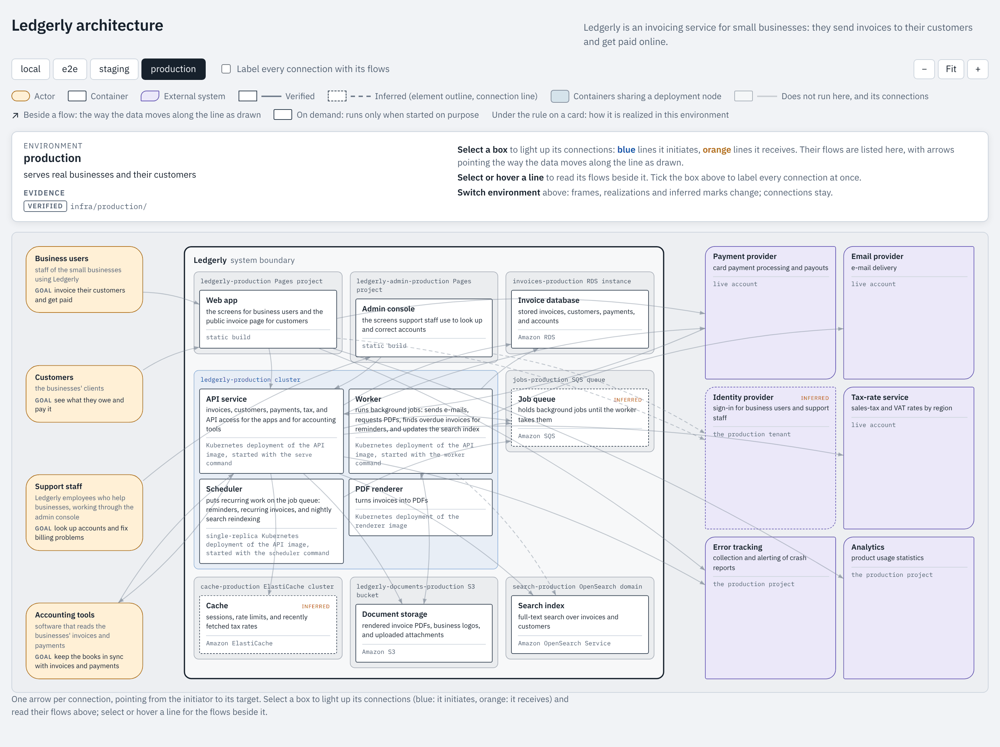
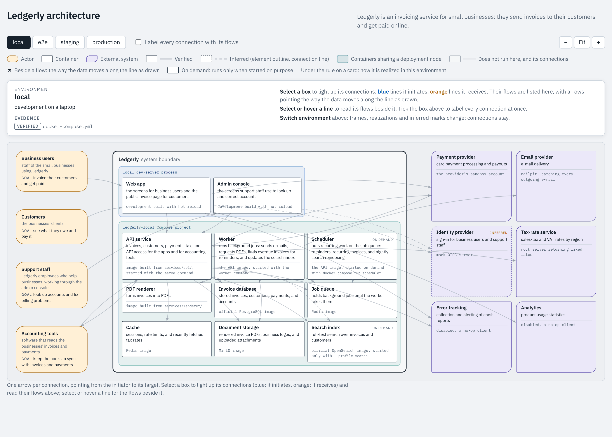

# software-architecture

Identifies a software system's architecture from its code and configuration, writes it down as
an architecture document, and draws it as an interactive diagram that switches between
environments.



*Ledgerly, a made-up invoicing system, in its production environment. Dashed outlines mark what
was inferred rather than verified.
[Open the live diagram](https://claude.ai/artifact/GqQepohn3V1cJWVWms3gMT).*

## What you get

- **An architecture document** (`ARCHITECTURE.md`): the system's boundary, the actors and
  external systems around it, the containers inside it, how they communicate, and how each
  environment realizes them. Every claim carries its evidence: the file or config it was
  verified from, or the signal it was inferred from.
- **A visualization**: one picture of the containers inside the boundary, with the actors and
  external systems around it. Switch environments to see how deployment groups the containers
  and what counts as inferred there. Select a box or a line to read its flows.



*The same system in the local environment: one Compose project instead of a cluster, mocks in
place of the real providers.*

## Use it

With a DevFlow Coordinator, the skill triggers on its own whenever the conversation turns to a
system's architecture. Outside DevFlow, ask for it by name in any repo:

```
Use the software-architecture skill to document this repo's architecture, then visualize it.
```

I use it on my codebase at work. Ledgerly is the showcase here because its complexity can be
tuned freely.

## How it looks at a system

A system has no single true picture, so the skill works with two established frameworks:
the C4 model's zoom levels, and the 4+1 architectural views as lenses. The document stops at
the Container level, since components are inferable from code. The diagram follows the
Physical lens: containers that share a deployment node in the chosen environment are grouped.

The details are in [SKILL.md](SKILL.md) and its references:
[the document template and the evidence rule](references/architecture-document.md), and
[how the diagram is drawn](references/architecture-visualization.md).

## Example document

The architecture document for Ledgerly, as the skill writes it. The live diagram above was
built on a larger version of Ledgerly than this document describes.

<!-- include: references/architecture-document-example.md from="## Context" to="## Environments" shift=1 -->

### Context

Ledgerly lets small businesses send invoices and get paid online.

#### Actors
- **Business users**: staff of the small businesses using Ledgerly
  - Goal: bill their customers and get paid
  - Evidence: verified: `web/src/routes/`
- **Customers**: the businesses' clients
  - Goal: see what they owe and pay it
  - Evidence: verified: `web/src/routes/pay/`
- **Accounting tools**: bookkeeping software of the businesses
  - Goal: keep the books in sync with invoices and payments
  - Evidence: verified: `api/routes/public.py`

#### External systems
- **Payment provider**
  - Provides: card payment processing
  - Evidence: verified: `api/payments/client.py`
- **Email provider**
  - Provides: e-mail delivery
  - Evidence: verified: `worker/mail/sender.py`
- **Identity provider**
  - Provides: sign-in for business users
  - Evidence: inferred: OIDC settings in `api/config/auth.py` name no provider

### Containers

#### Web app
- Responsibility: the screens for business users and the public invoice page for customers
- Technology: TypeScript single-page app
- Evidence: verified: `web/`

#### API service
- Responsibility: invoices, customers, payments, and API keys
- Technology: Python web service
- Evidence: verified: `api/`

#### Invoice database
- Responsibility: stored invoices, customers, payments, and accounts
- Technology: PostgreSQL
- Evidence: verified: `api/db/migrations/`

#### PDF renderer
- Responsibility: turns invoices into PDFs
- Technology: headless-browser render service
- Evidence: verified: `renderer/`

#### Job queue
- Responsibility: holds e-mail and reminder jobs until the worker takes them
- Evidence: verified: `api/jobs/`

#### Worker
- Responsibility: sends invoice and reminder e-mails, and finds overdue invoices for reminders
- Technology: Python worker process
- Evidence: verified: `worker/`

### Communication
- **Business users → Web app**
  - Flows:
    - → invoice and settings edits
    - ← invoices and PDF downloads
  - Evidence: verified: `web/src/routes/`
- **Customers → Web app**
  - Flows:
    - → invoice link opens
    - ← invoice view and PDF download
  - Evidence: verified: `web/src/routes/pay/`
- **Accounting tools → API service**
  - Flows:
    - → invoice and payment queries
    - ← invoices and payments
  - Evidence: verified: `api/routes/public.py`
- **Payment provider → API service**
  - Flows:
    - → payment results
  - Evidence: verified: `api/routes/webhooks.py`
- **Web app → Payment provider**
  - Flows:
    - → card details
    - ← payment confirmation
  - Evidence: verified: `web/src/routes/pay/checkout.ts`
- **Web app → Identity provider**
  - Flows:
    - → sign-in request
    - ← identity token
  - Evidence: inferred: OIDC settings in `api/config/auth.py`
- **Web app → API service**
  - Flows:
    - → invoice and settings edits
    - ← invoices, payment status, PDFs
  - Evidence: verified: `web/src/api/client.ts`
- **API service → Accounting tools**
  - Flows:
    - → invoice and payment updates
  - Evidence: verified: `api/webhooks/outgoing.py`
- **API service → Invoice database**
  - Flows:
    - → invoice, customer, and payment writes
    - ← stored records
  - Evidence: verified: `api/db/`
- **API service → PDF renderer**
  - Flows:
    - → invoice data
    - ← rendered PDFs
  - Evidence: verified: `api/pdf/client.py`
- **API service → Job queue**
  - Flows:
    - → e-mail and reminder jobs
  - Evidence: verified: `api/jobs/enqueue.py`
- **Worker → Email provider**
  - Flows:
    - → invoice and reminder e-mails
  - Evidence: verified: `worker/mail/sender.py`
- **Worker → Invoice database**
  - Flows:
    - ← overdue invoices
  - Evidence: verified: `worker/reminders.py`
- **Worker → Job queue**
  - Flows:
    - ← e-mail and reminder jobs
  - Evidence: verified: `worker/main.py`

<!-- /include -->

<details>
<summary>Environments: local, test, staging, production</summary>

<!-- include: references/architecture-document-example.md from="## Environments" to="```" shift=1 -->

### Environments

#### local
- Purpose: development on a laptop
- Evidence: verified: `docker-compose.yml`
- Containers:
  - **Web app**: development build with hot reload
    - Deployment node: local Vite dev server
    - Evidence: verified: `web/vite.config.ts`
  - **API service**: image built from `api/`
    - Deployment node: ledgerly-local Compose project
    - Evidence: verified: `docker-compose.yml`
  - **Invoice database**: official PostgreSQL image
    - Deployment node: ledgerly-local Compose project
    - Evidence: verified: `docker-compose.yml`
  - **PDF renderer**: image built from `renderer/`
    - Deployment node: ledgerly-local Compose project
    - Evidence: verified: `docker-compose.yml`
  - **Job queue**: Redis image
    - Deployment node: ledgerly-local Compose project
    - Evidence: verified: `docker-compose.yml`
  - **Worker**: image built from `worker/`
    - Deployment node: ledgerly-local Compose project
    - Evidence: verified: `docker-compose.yml`
- External systems:
  - **Payment provider**: the provider's test mode
    - Evidence: verified: `.env.example`
  - **Email provider**: Mailpit, catching every outgoing e-mail
    - Evidence: verified: `docker-compose.yml`
  - **Identity provider**: mock OIDC server
    - Evidence: verified: `docker-compose.yml`

#### test
- Purpose: end-to-end tests in CI
- Evidence: verified: `.ci/pipeline.yml`
- Containers:
  - **Web app**: image serving the production build
    - Deployment node: ledgerly-e2e Compose project
    - Evidence: verified: `e2e/docker-compose.yml`
  - **API service**: image built from `api/`
    - Deployment node: ledgerly-e2e Compose project
    - Evidence: verified: `e2e/docker-compose.yml`
  - **Invoice database**: official PostgreSQL image
    - Deployment node: ledgerly-e2e Compose project
    - Evidence: verified: `e2e/docker-compose.yml`
  - **PDF renderer**: image built from `renderer/`
    - Deployment node: ledgerly-e2e Compose project
    - Evidence: verified: `e2e/docker-compose.yml`
  - **Job queue**: Redis image
    - Deployment node: ledgerly-e2e Compose project
    - Evidence: verified: `e2e/docker-compose.yml`
  - **Worker**: image built from `worker/`
    - Deployment node: ledgerly-e2e Compose project
    - Evidence: verified: `e2e/docker-compose.yml`
- External systems:
  - **Payment provider**: mock server
    - Evidence: verified: `e2e/docker-compose.yml`
  - **Email provider**: Mailpit, catching every outgoing e-mail
    - Evidence: verified: `e2e/docker-compose.yml`
  - **Identity provider**: mock OIDC server
    - Evidence: verified: `e2e/docker-compose.yml`

#### staging
- Purpose: pre-release checks against production-like services
- Evidence: verified: `infra/staging/`
- Containers:
  - **Web app**: static build
    - Deployment node: ledgerly-staging Pages project
    - Evidence: verified: `infra/staging/web.tf`
  - **API service**: Kubernetes deployment of the API image
    - Deployment node: ledgerly-staging cluster
    - Evidence: verified: `infra/staging/api.tf`
  - **Invoice database**: Amazon RDS
    - Deployment node: invoices-staging RDS instance
    - Evidence: verified: `infra/staging/database.tf`
  - **PDF renderer**: Kubernetes deployment of the renderer image
    - Deployment node: ledgerly-staging cluster
    - Evidence: verified: `infra/staging/renderer.tf`
  - **Job queue**: Amazon SQS
    - Deployment node: jobs-staging SQS queue
    - Evidence: inferred: `api/config/queue.py` reads a queue URL from the environment; no infrastructure definition in this repository
  - **Worker**: Kubernetes deployment of the worker image
    - Deployment node: ledgerly-staging cluster
    - Evidence: verified: `infra/staging/worker.tf`
- External systems:
  - **Payment provider**: the provider's test mode
    - Evidence: verified: `infra/staging/config.yaml`
  - **Email provider**: the real provider, sending only to internal addresses
    - Evidence: verified: `infra/staging/config.yaml`
  - **Identity provider**: a staging tenant
    - Evidence: inferred: OIDC settings in `api/config/auth.py` name no provider

#### production
- Purpose: serves real customers
- Evidence: verified: `infra/production/`
- Containers:
  - **Web app**: static build
    - Deployment node: ledgerly-production Pages project
    - Evidence: verified: `infra/production/web.tf`
  - **API service**: Kubernetes deployment of the API image
    - Deployment node: ledgerly-production cluster
    - Evidence: verified: `infra/production/api.tf`
  - **Invoice database**: Amazon RDS
    - Deployment node: invoices-production RDS instance
    - Evidence: verified: `infra/production/database.tf`
  - **PDF renderer**: Kubernetes deployment of the renderer image
    - Deployment node: ledgerly-production cluster
    - Evidence: verified: `infra/production/renderer.tf`
  - **Job queue**: Amazon SQS
    - Deployment node: jobs-production SQS queue
    - Evidence: inferred: `api/config/queue.py` reads a queue URL from the environment; no infrastructure definition in this repository
  - **Worker**: Kubernetes deployment of the worker image
    - Deployment node: ledgerly-production cluster
    - Evidence: verified: `infra/production/worker.tf`
- External systems:
  - **Payment provider**: live account
    - Evidence: verified: `infra/production/config.yaml`
  - **Email provider**: the real provider
    - Evidence: verified: `infra/production/config.yaml`
  - **Identity provider**: the production tenant
    - Evidence: inferred: OIDC settings in `api/config/auth.py` name no provider

<!-- /include -->

</details>
